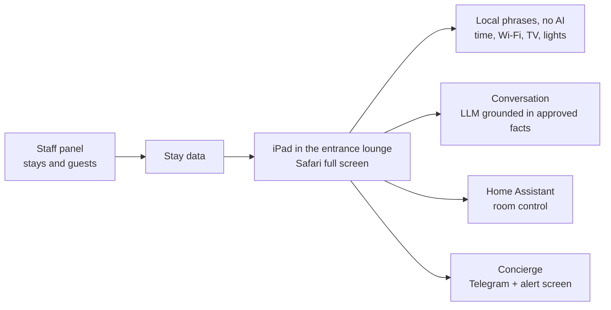

# AI Guest Concierge on a Tablet: Case Study

> An AI assistant on an iPad in the entrance lounge of an event venue's guest house (**Vale Verde Festas**): it greets the couple by name, answers questions, shows the stay details, controls the room and calls the concierge.
> **Status: in development.** **Source code is private.** This repository documents the project; a walkthrough is available on request.

## What it does

- **Greets the guests by name** during their stay. The name comes from the booking, never from a camera (privacy by design: no camera, no face recognition).
- **Answers questions** with freedom to talk, but **only states what is in an approved fact** about the venue; prices are never quoted by the AI.
- **The stay**: Wi-Fi QR code, time, weather and rain, alarms and reminders (planned), the weekend's schedule.
- **The room** (next phase): air conditioning, TV, lights and scenes through Home Assistant.
- **Calls the concierge** through a Telegram bot and an alert on the concierge's screen.
- **Staff panel** to register each stay (guests, dates, language); the stay's memory is wiped at check-out.

## Architecture

- pnpm monorepo: `tablet` and `panel` apps plus packages for knowledge (approved facts), stays, house control, concierge and the animated mascot (the assistant's face, with states such as listening, sleeping and muted).
- Simple commands are answered locally without AI, so they are instant and work offline; the LLM is used only for conversation.
- Rolled out in phases: tablet page and stays panel → connected room → voice in Portuguese → learning with an approval queue → second guest house.

## My role

Product design, architecture and full stack development.

---
Built by **Victor Sestrem** · [LinkedIn](https://www.linkedin.com/in/victor-sestrem/) · victor-sestrem@hotmail.com
